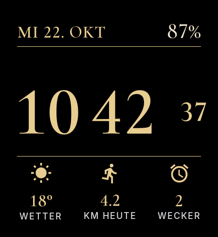

# Garmin Designer – Zifferblatt „Elegant“ für die Venu X1

Connect-IQ-Zifferblatt, erzeugt aus [`design/mein-design.json`](design/mein-design.json).
GitHub baut daraus bei jedem Push automatisch die Datei **`ElegantFace.prg`**.

## Einmalig einrichten

Im Repository auf GitHub: **Settings → Secrets and variables → Actions → New repository secret**
und diese zwei Einträge anlegen:

| Name | Wert |
|---|---|
| `GARMIN_USERNAME` | E-Mail-Adresse deines Garmin-Kontos |
| `GARMIN_PASSWORD` | Passwort deines Garmin-Kontos |

Damit lädt der Bau das Connect IQ SDK und die Gerätedaten der Venu X1 von Garmin.
Ist für das Garmin-Konto eine Zwei-Faktor-Anmeldung aktiv, klappt das automatische Login nicht.

Danach unter **Actions → Zifferblatt bauen → Run workflow** den Bau starten.

## .prg auf die Uhr bringen

1. Unter **Releases → neueste** die Datei `ElegantFace.prg` herunterladen.
2. Uhr per USB anschließen und die Datei in den Ordner **`GARMIN/APPS`** kopieren
   (auf dem Mac mit *OpenMTP* oder *Android File Transfer*).
3. Uhr trennen, Zifferblatt lange drücken und **Elegant** auswählen.

## Was angezeigt wird

| Element | Datenquelle |
|---|---|
| Datum oben links | Wochentag, Tag, Monat (Sprache der Uhr) |
| Akku oben rechts | Ladestand in % |
| Stunden, Minuten, Sekunden | Uhrzeit (12/24 h wie in der Uhr eingestellt) |
| Wetter | aktuelle Temperatur aus Garmin-Wetter (°C/°F wie eingestellt) |
| KM heute | heute zurückgelegte Strecke („MI HEUTE“ bei Meilen) |
| Wecker | Anzahl der eingestellten Wecker |

Im Always-on-Modus zeigt das Zifferblatt nur eine kleine, gedimmte Uhrzeit, die jede Minute
ein Stück wandert, damit das AMOLED-Display nicht einbrennt.

## Aufbau

- `ElegantFace/` – das Connect-IQ-Projekt (Monkey C, Schriften, Icons)
- `design/` – das Design aus dem Editor
- `tools/` – Skripte, mit denen Schriften, Icons und Vorschau erzeugt wurden
  (Schrift: Cormorant Garamond aus `@fontsource/cormorant-garamond`, Inter Medium)
